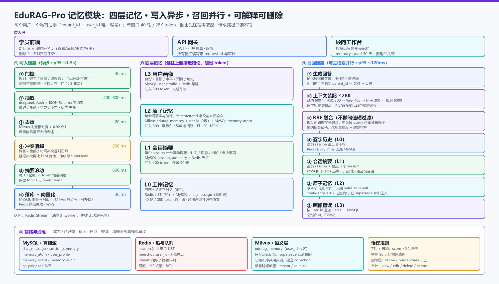

# EduRAG-Pro 记忆模块设计（v1.0 定稿）

> 状态：**已拍板**（2026-10-19）。5 条决策见 §1，参数见 §11，接口见 §10。
> 模块定位：让每个用户拥有一个**私有、可解释、可删除**的 AI 助手上下文；为 RAG 主链路提供"这个人在说什么"的背景，而不是替代知识库。
> 参考：[TencentDB Agent Memory](https://cloud.tencent.cn/document/product/1813/132100)（四层金字塔 + 混合检索 + 白盒溯源），本项目取其"分层 + 溯源"思想，不做团队记忆。

---

## 1. 已拍板的决策

| # | 决策 | 落地要点 |
|---|---|---|
| 1 | **单窗口 40 轮 + 28 K token 双上限**，先到先压 | 超过任一上限即触发压缩：滚动摘要 + 原子抽取 + 原文归档 |
| 2 | **做"我的记忆"页** | 查看 / 筛选 / 编辑 / 删除（含链式删除二选一）/ 清空 / 导出 |
| 3 | **顾问可看学员记忆** | `role × scope` 权限矩阵 + 每次查看写审计 |
| 4 | **不做团队/机构记忆** | 留 v2；但 `tenant_id` 字段现在留位 |
| 5 | **抽取与摘要模型用 `deepseek-flash`** | 异步调用，失败重试 3 次进死信 |
| 6 | 删除 supersede 链**最新一条**时二选一 | `revive`（恢复上一条生效）或 `purge_chain`（整链失效） |

对应地，原讨论稿里"逐字历史注入 ≤2.5 K"作废——**28 K 是单请求输入总上限**，逐字历史可以吃到剩余预算（见 §4）。

---

## 2. 模块总览



```
                     ┌─────────────── 一次请求 ───────────────┐
 用户提问 ──► 接入 ──► 召回（4 路并行 ≤120ms）──► 上下文装配 ≤28K ──► 生成 ──► 回答
                            ▲                                              │
                            │                                   ┌──────────┘
                            │                                   ▼
         L3 画像 ── L1 摘要 ── L2 原子记忆 ── L0 逐字窗口  写入（异步 ≤1.5s）
                            ▲                                   │
                            └────────── 门控 → 抽取 → 合并 → 冲突 → 摘要滚动 ┘
```

三条链路、四层存储、两套治理（TTL/衰减、删除/审计）。**请求路径只读不写**，所有写入都进异步队列，这是延迟可控的根本。

---

## 3. 四层记忆

| 层 | 内容 | 存储 | 窗口/容量 | 注入量 |
|---|---|---|---|---|
| **L0 工作记忆** | 当前会话逐字对话 | Redis LIST（热）+ MySQL `chat_message`（真相源） | **40 轮 / 28 K token**，超限压缩 | 剩余预算，最多约 20 K |
| **L1 会话摘要** | 每个 session 一份滚动摘要（时间、话题、结论、未决事项） | MySQL `session_summary` + Redis 热点 | 400 token/会话，90 天 | 400 |
| **L2 原子记忆** | 跨会话事实/偏好/决定，带结构化字段与来源 | Milvus `edurag_memory`（`user_id` 分区）+ MySQL `memory_atom` | 每用户 ≤500 条活跃，按类型 TTL | 300（top5） |
| **L3 用户画像** | 身份、目标、水平、预算、地域 | MySQL `user_profile` + Redis | 300 token，长期 | 300 |

**分层原则**：L0 保"原话"，L1 保"这段聊了什么"，L2 保"这个人是谁、要什么"，L3 保"稳定属性"。越往上越接近结论、越省 token、越需要溯源链接。

---

## 4. 上下文装配与压缩

### 4.1 单请求预算（总 ≤ 28 K，模型上下文 32 K，留 4 K 给输出）

| 段 | 上限 | 超了怎么办 |
|---|---|---|
| 系统提示 + 工具说明 | 600 | 固定，压缩 prompt 本身 |
| L3 画像 | 300 | 砍次要字段（城市/联系方式先砍） |
| L1 当前会话摘要 | 400 | 只留未决事项 + 最近结论 |
| L2 原子记忆 | 300 | 按 `confidence × recency` 取前 N |
| 知识库上下文 | 6000 | 父块 4–6 个（已有裁剪） |
| **L0 逐字历史** | **剩余预算（约 20 K）** | 从最旧开始丢，丢出去的进摘要 |
| 合计 | 28 000 | 超限 → 触发 §4.2 压缩后再装配 |

### 4.2 压缩规则（40 轮 / 28 K 双阈值）

| 项 | 规则 |
|---|---|
| 触发 | `turn_no > 40` **或** 估算 token > 28 000（估算：`字符数 × 0.7`，中文偏保守） |
| 压缩对象 | 最旧的 K 轮（默认 10 轮，可配） |
| 压缩动作 | ① 增量并入 L1 滚动摘要（旧摘要 + 新轮次 → 新摘要，保留 `topics` / `open_items`）② 门控后抽取 L2 原子记忆 ③ 原文标记 `archived=1`（**不删**，仍可下钻） |
| 执行位置 | 异步 worker（Redis Stream），不在请求路径 |
| 幂等 | `(session_id, up_to_turn)` 唯一，重复消息不重复摘要 |
| 失败 | 重试 3 次；仍失败保留原文并告警，**绝不丢数据** |

### 4.3 为什么"压缩"不是"截断"

截断丢的是原话（用户第 3 轮说的"我零基础"），摘要丢的是细节（金额、日期）。所以压缩 = **摘要 + 结构化抽取** 双写：摘要保语义连贯，原子记忆保事实字段，原文归档保可追溯。三者缺一，回答就会"记得大概、答错细节"。

---

## 5. 写入链路（异步，p95 ≤ 1.5 s）

```text
回答结束 → ① 门控 → ② 抽取 → ③ 去重 → ④ 冲突消解 → ⑤ 摘要滚动 → ⑥ 落库+向量化
```

| 步 | 做什么 | 技术 | 耗时预算 |
|---|---|---|---|
| ① 门控 | 判断这轮值不值得记 | 规则（数字/日期/课程名/"我要/改/不去/多少钱"）+ 长度阈值；命中即过 | 30 ms |
| ② 抽取 | 输出结构化 JSON | `deepseek-flash` + JSON Schema 强约束 | 400–800 ms |
| ③ 去重 | 与同用户已有记忆比对 | Milvus 向量相似度 > 0.92 → 合并（保留信息量大的表述） | 20 ms |
| ④ 冲突消解 | 语义相反则 supersede | 规则（科目/金额/时间冲突）+ LLM 判定 | 200 ms（仅疑似冲突时） |
| ⑤ 摘要滚动 | 每 10 轮或 3 K token | `deepseek-flash` 增量摘要 | 600 ms |
| ⑥ 落库 | MySQL 明细 + Milvus 向量 + Redis 失效 | 事务写 MySQL → 异步写 Milvus（可补偿） | 30 ms + 向量 20 ms |

抽取输出（JSON Schema 强约束，字段缺失即重试）：

```json
{
  "worth_remembering": true,
  "fact_type": "preference | identity | constraint | decision | progress",
  "subject": "AI大模型",
  "content": "用户计划 2026 年 3 月前入职，预算 2 万以内，零基础",
  "structured": {"budget_cny": 20000, "deadline": "2026-03", "level": "零基础"},
  "confidence": 0.86,
  "conflicts_with": ["m_7f2a"]
}
```

门控的收益：教育场景约 40% 轮次是寒暄/确认/重复提问，全量抽取会让 L2 在 3 个月膨胀到数千条，召回被噪声占满。

### 5.1 门控：规则打分，**不用大模型**

门控回答的是"这轮值不值得记"，不是"用户在问什么"。用大模型做门控有三个问题：延迟进请求路径、每轮多一次调用、与紧随其后的抽取重复付费。规则 + 便宜信号足够：

| 信号 | 判据 | 权重 |
|---|---|---|
| 事实信号 | 数字 / 金额 / 日期 / 时长（正则 + 数量词） | 高 |
| 意图信号 | "我要 / 打算 / 改 / 不去 / 想学 / 什么时候 / 多少钱" | 高 |
| 实体信号 | 命中 `subject` / `course` 词典（复用 Tag 体系） | 中 |
| 反馈信号 | "太贵 / 不合适 / 没时间 / 已经报了" | 中 |
| 新颖度 | 与最近 3 轮余弦相似度 < 0.9（重复追问直接丢） | 负向 |
| 长度 | < 4 字且无实体（"好的""谢谢"）直接丢 | 负向 |

`score ≥ 2` 进抽取；仅"意图信号 + 短句"进 L1 摘要不入 L2。**门控只决定是否抽取，不决定抽什么**；被丢弃的轮次仍在 L0 原文里，支持"事后补抽"（发现漏记时按 `session_id + 轮次` 回灌抽取任务）。

意图分类的输出可以作为门控的一路特征（例如"课程咨询 + 出现预算"→ 高概率可记），但两者不是同一个任务，不要复用同一个模型出结论。

### 5.2 抽取什么：五类事实 + 证据 + 主体

| `fact_type` | 抽什么 | 字段示例 |
|---|---|---|
| `identity` 身份 | 学历 / 专业 / 年级 / 城市 / 工作年限 / 在职与否 | `{"education":"本科","major":"机械","city":"成都"}` |
| `preference` 偏好 | 学习方式（视频/直播/面授）、时间偏好、讲解风格、班型 | `{"style":"项目驱动","time":"工作日晚"}` |
| `constraint` 约束 | 预算、截止时间、每周可投入时长、地域、基础水平 | `{"budget_cny":20000,"deadline":"2026-03","level":"零基础"}` |
| `decision` 决定 | 已选方向/课程、已报名、放弃某路线、确定学习计划 | `{"course":"AI大模型7.5","status":"已定金"}` |
| `progress` 进度 | 学到哪、卡在哪、上次没做完的事 | `{"stage":"Transformer","blocker":"矩阵乘法"}` |

每条必须带：`evidence`（原话片段，做溯源）、`who`（`self` / `other`，判断"我朋友预算 2 万"不属于本人）、`session_id + msg_ids`、`confidence`。

**不抽**：寒暄与情绪、当轮就答完的通用知识问答（那是知识库的事）、可公开检索的课程信息（属文档，不属记忆）。

### 5.3 冲突消解：处理"互相打架的记忆"，但动作是 supersede 不是覆盖

| 情况 | 判定 | 动作 |
|---|---|---|
| 同槽位新值（预算 2 万 → 3 万） | 规则：同 `subject + slot_key`、值不等 | 新记忆 `superseded_by` 指向旧的，旧记忆 `valid_to=now` |
| 语义相反（想学 AI → 不学了） | 规则判不了，LLM 单次判定（批量送候选） | 同上，整条 supersede |
| 信息互补（预算 2 万 + 截止 3 月） | 同槽位族、字段不重叠 | **合并**成一条，不新建第二条 |
| 时效失效（"3 月前入学"已过 3 月） | 与时间字段比较 | 置 `valid_to`，不算冲突 |

三个易错点：① 覆盖式更新会丢掉"改口历史"，链就断了，`revive` 也无从恢复；② 不做 `who` 判定会把别人的信息记成自己的；③ 冲突判定必须发生在去重**之后**（否则两条冗余记录会互相判冲突）。

---

## 6. 召回链路（与主检索并行，p95 ≤ 120 ms）

| 路 | 查询 | 数据源 | 超时降级 |
|---|---|---|---|
| A 画像 | 按 `user_id` 直读 | Redis → MySQL | 必然命中，不降级 |
| B 原子记忆 | query 向量 top5 | Milvus `user_id` 分区 + `valid_to is null` + `confidence ≥ 0.6` | 跳过，仅用 A/D |
| C 会话摘要 | 当前 session + 最近 3 个 session | MySQL（Redis 热点） | 只用当前会话摘要 |
| D 逐字历史 | 当前 session 最近若干轮 | Redis LIST | 回源 MySQL |

融合：B/C 两路用 **RRF**（不做阈值硬过滤——中文短 query 余弦分布很扁，阈值会误杀）。装配顺序固定为"系统 → 画像 → 摘要 → 原子记忆 → 知识 → 逐字"，**固定段在前**以命中 provider 前缀缓存。

---

## 7. supersede 链与删除语义（新增重点）

### 7.1 链模型

```
m_001 (Java, 2026-08)  --superseded_by-->  m_007 (AI, 2026-10)  --superseded_by-->  m_012 (AI+预算, 2026-10-19)
   valid_to=2026-10-01                        valid_to=2026-10-19                        valid_to=NULL（活动）
   chain_root_id=m_001                        chain_root_id=m_001                        chain_root_id=m_001
```

- 每条记忆有 `chain_root_id`；supersede 时新记忆继承 root，旧记忆写 `valid_to` 与 `superseded_by`。
- 召回只取 `valid_to is null AND deleted_at is null`，所以链上历史天然不会被注入。
- 链的价值：**改口可追溯**（"你之前说的是 Java，现在改 AI 了，对吗？"），也是审计与纠错的依据。

### 7.2 删除"链上最新一条"的两种语义

| 模式 | 语义 | 动作 | 适用场景 |
|---|---|---|---|
| `revive`（恢复上一条） | "我记错了，改回上一版" | 删除目标条 → 将它的前驱置 `valid_to=null`、`superseded_by=null`，恢复为活动记忆 | 用户改口后又反悔；抽取出错 |
| `purge_chain`（整链失效） | "就当我没说过" | 整链 `deleted_at=now`，Milvus 标记删除，Redis 相关 key 失效 | 用户要撤回某类信息；合规删除 |

- **默认建议 `revive`**（破坏性小），UI 上两个按钮并列，文案写清后果："恢复上一条（AI 之前的说法）"/"整条删除（不再记住这件事）"。
- 删除**中间条**：只删该条，并把它的后继 `superseded_by` 改指它的前驱（保持链连续）；或直接 `purge_chain`。
- 删除后必须：清 Redis（`mem:hot:{user_id}`、`mem:sum:*` 若涉及）→ Milvus 逻辑删除 → 写 `memory_audit` → 记忆页立刻刷新。

### 7.3 级联与审计

| 动作 | 级联 |
|---|---|
| 单条删除 | Redis 热点失效 + Milvus 删除 + 审计 |
| 整链删除 | 同上 + 该链所有向量删除 |
| 清空全部记忆 | 用户维度删除 L2 + L3 + L1（L0 原文按保留策略留 180 天，可另选"全删"） |
| 账号注销 | 全量级联 + 导出归档（合规要求） |

删除是**软删**（`deleted_at`），物理清理由离线任务在 30 天后执行——留出误删恢复窗口。

---

## 8. 记忆页（"我的记忆"）

### 8.1 页面结构

| 区块 | 内容 | 交互 |
|---|---|---|
| 画像卡 | 目标、水平、预算、地域、最近更新时间 | 就地编辑（改完立即影响下次回答） |
| 记忆列表 | 按类型分组（偏好/身份/约束/决定/进度），显示 content、时间、置信度、"为什么记住" | 筛选、搜索、编辑、删除 |
| 来源下钻 | 点"为什么记住"→ 跳转到原始会话的对应轮次（`session_id + msg_ids`） | 只读 |
| 会话摘要 | 每个会话一段摘要 + 未决事项 | 可删除单个会话记忆 |
| 链视图 | 同一事实的版本时间线（Java → AI → AI+预算） | 选择 `revive` / `purge_chain` |
| 危险区 | 清空全部记忆、导出我的数据（JSON） | 二次确认 + 审计 |

### 8.2 展示规则

- 默认只展示**活动记忆**；"显示历史版本"开关打开后显示链上旧版（灰色 + 划掉）。
- 每条显示：`fact_type` 徽标、`confidence` 用文字（高/中/低）而非小数、时间用"3 天前"。
- 删除后 **toast 提示可撤销 10 秒**（`revive` 的 UX 版），超过则走审计记录的恢复流程。

---

## 9. 权限与审计

| 主体 | L3 画像 | L1 摘要 | L2 原子记忆 | L0 原文 | 说明 |
|---|---|---|---|---|---|
| 学员本人 | 读写 | 读 | 读写删 | 读 | 记忆页 |
| 顾问 | 只读（授权后） | 只读 | 只读 | 只读（授权后） | 查看前弹授权 + 写审计 |
| 机构管理员 | 只读 | 只读 | 只读 | 不可读原文 | 聚合统计为主，默认不看原文 |
| 系统 worker | 读写 | 读写 | 读写 | 写 | 抽取/摘要/衰减任务 |

- 授权模型：`memory_grant(user_id, grantee_id, scope, expires_at)`，默认 30 天，可撤销。
- 审计：`memory_audit(id, actor, action, target_type, target_id, user_id, ip, at, detail)`；`action ∈ {view, edit, delete, revive, purge_chain, export}`。
- 未成年人/敏感信息：手机号、身份证、住址在抽取阶段脱敏（只存掩码），不进 L2 向量。

---

## 10. 接口清单

| 方法 | 路径 | 说明 |
|---|---|---|
| `GET` | `/v1/memory/profile` | 读画像 |
| `PATCH` | `/v1/memory/profile` | 改画像（触发下次召回立即生效） |
| `GET` | `/v1/memory/atoms?type=&status=&page=` | 记忆列表（默认仅活动） |
| `GET` | `/v1/memory/atoms/{id}` | 详情（含来源轮次） |
| `PATCH` | `/v1/memory/atoms/{id}` | 编辑 content / structured |
| `DELETE` | `/v1/memory/atoms/{id}?mode=revive\|purge_chain` | 链式删除 |
| `GET` | `/v1/memory/atoms/{id}/chain` | 链视图 |
| `GET` | `/v1/memory/sessions` | 会话列表（标题=摘要首句） |
| `GET` | `/v1/memory/sessions/{id}/summary` | 会话摘要 + 未决事项 |
| `DELETE` | `/v1/memory/sessions/{id}` | 删除某会话记忆（摘要 + 该会话抽取的原子记忆） |
| `POST` | `/v1/memory/export` | 导出全量记忆（异步生成 JSON，返回下载链接） |
| `DELETE` | `/v1/memory/all` | 清空（二次确认 token） |
| `GET` | `/v1/admin/users/{user_id}/memory` | 顾问/管理员查看（需授权，写审计） |
| `POST` | `/v1/admin/memory-grants` | 授予/撤销查看权限 |

---

## 11. 参数基线

| 参数 | 值 | 说明 |
|---|---|---|
| `MEM_WINDOW_TURNS` | **40** | 单窗口轮数上限 |
| `MEM_WINDOW_TOKENS` | **28000** | 单窗口 token 上限（估算 `字符×0.7`） |
| `MEM_COMPRESS_BATCH_TURNS` | 10 | 每次压缩的轮数 |
| `MEM_ROLLUP_TOKENS` | 3000 | 摘要滚动触发（次级阈值） |
| `MEM_SUMMARY_MAX_TOKENS` | 400 | 单会话摘要上限 |
| `MEM_RECALL_TOP_K` | 5 | 原子记忆召回条数 |
| `MEM_RECALL_BUDGET_MS` | 120 | 召回超时即降级 |
| `MEM_MIN_CONFIDENCE` | 0.6 | 低于此不注入 |
| `MEM_DEDUPE_SIM` | 0.92 | 合并阈值 |
| `MEM_PROFILE_MAX_TOKENS` | 300 | 画像注入上限 |
| `MEM_ATOM_MAX_TOKENS` | 300 | 原子记忆注入上限 |
| `MEM_ATOM_LIMIT_PER_USER` | 500 | 活跃记忆条数上限，超出按 score 归档 |
| TTL | 偏好 180d / 事实 90d / 约束 7d / 摘要 90d / 原文 180d | 衰减：`score = conf × exp(-age/90d) × (1+0.1×引用次数)`，<0.2 归档 |

---

## 12. 指标与验收

| 指标 | 目标 |
|---|---|
| MemRecall@5 | ≥ 0.85（100 题记忆回归集） |
| 事实准确率（金额/日期/课程名） | ≥ 0.95 |
| 过期污染率（召回到已 supersede） | ≤ 2% |
| 记忆 token 占比 | ≤ 10% |
| 召回 p95 | ≤ 120 ms |
| 写入 p95 / 积压 | ≤ 1.5 s / < 200 条 |
| 删除生效延迟 | ≤ 2 s（记忆页即时，召回侧最迟 2 s） |
| 链操作正确率 | 100%（`revive` 后旧记忆必须回到活动态，`purge_chain` 后整链不可召回） |

验收必做两组对照：**开/关记忆**（MemRecall 提升 < 5pp 但 P95 恶化 > 100 ms 即为负收益）、**revive vs purge**（构造 20 条链，逐条验证召回结果）。

---

## 13. 复杂度控制（适当减法）

| 不做 | 原因 |
|---|---|
| 团队/机构记忆 | 本期无多 Agent 协同需求，先把个人记忆做对 |
| 记忆图谱（实体关系图） | L2 的 `subject + structured` 已够覆盖教育场景的检索需求 |
| 多层摘要树（日/周/月） | 单层滚动摘要 + 90 天 TTL 已能覆盖，多级摘要维护成本高、收益低 |
| 记忆重要性模型训练 | 先用规则 + 置信度 + 衰减，有标注数据再谈模型 |
| 向量库独立集群 | 与知识库共用 Milvus，独立 collection + 分区键即可 |

**保留了三个"看似多余"的设计**，因为它们是交付底线：原文归档（可追溯）、审计表（合规）、软删 + 30 天恢复窗口（误删兜底）。
